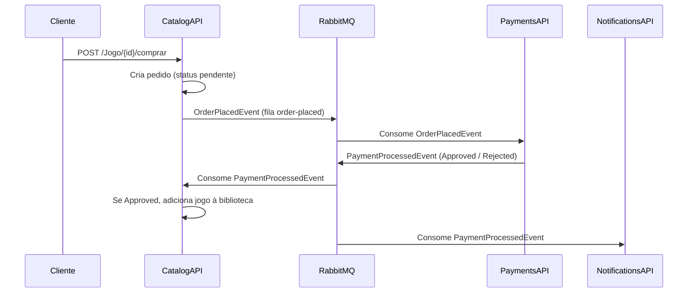

# CatalogAPI

Microsserviço de catálogo de jogos da plataforma **FIAP Cloud Games (FCG)**. É responsável pelo CRUD de jogos e por iniciar o fluxo de compra, de forma assíncrona, via mensageria.

Projeto desenvolvido para o **Tech Challenge – Fase 2 (FIAP Pós Tech)**, em conjunto com os serviços UsersAPI, PaymentsAPI e NotificationsAPI.

## Sumário

- [Arquitetura](#arquitetura)
- [Tecnologias](#tecnologias)
- [Configuração](#configuração)
- [Execução local](#execução-local)
- [Containerização](#containerização)
- [Implantação no Kubernetes](#implantação-no-kubernetes)
- [Contratos de integração](#contratos-de-integração)
- [Endpoints](#endpoints)
- [Fluxo de compra](#fluxo-de-compra)
- [Troubleshooting](#troubleshooting)
- [Observações técnicas](#observações-técnicas)

## Arquitetura

O CatalogAPI participa de uma arquitetura de microsserviços orientada a eventos. A comunicação entre serviços é assíncrona, via RabbitMQ.



## Tecnologias

| Componente | Tecnologia |
|---|---|
| Plataforma | .NET 8, ASP.NET Core Web API |
| Persistência | Entity Framework Core, SQL Server |
| Mensageria | RabbitMQ (`RabbitMQ.Client`) |
| Autenticação | JWT Bearer |
| Documentação da API | Swagger |
| Containerização | Docker (multi-stage build) |
| Orquestração | Kubernetes |

## Configuração

A aplicação lê suas configurações do `appsettings.json` ou de variáveis de ambiente. Nas variáveis de ambiente do .NET, o separador `:` é substituído por `__` (ex.: `Jwt:Key` → `Jwt__Key`).

| Variável | Exemplo | Classificação |
|---|---|---|
| `ConnectionStrings__DefaultConnection` | `Server=db-catalog,1433;Database=CatalogAPI;User Id=sa;Password=...;TrustServerCertificate=True;` | Sensível |
| `Jwt__Key` | Chave de assinatura | Sensível |
| `Jwt__Issuer` | `TechChallenge` | Não sensível |
| `RabbitMQ__Host` | `rabbitmq` | Não sensível |
| `RabbitMQ__Port` | `5672` | Não sensível |
| `RabbitMQ__VirtualHost` | `/` | Não sensível |
| `RabbitMQ__User` | Usuário do broker | Sensível |
| `RabbitMQ__Password` | Senha do broker | Sensível |
| `RabbitMQ__OrderPlacedQueue` | `order-placed` | Não sensível |
| `RabbitMQ__PaymentProcessedQueue` | `catalog-payment-processed` | Não sensível |
| `ASPNETCORE_ENVIRONMENT` | `Development` (habilita o Swagger) | Não sensível |

> O token JWT emitido pelo UsersAPI deve utilizar o mesmo `Issuer` e a mesma `Key` configurados neste serviço. Caso contrário, as requisições serão rejeitadas com `401 Unauthorized`.

## Execução local

**Pré-requisitos:** .NET SDK 8, SQL Server (LocalDB ou outro) e Docker (para o RabbitMQ).

```bash
git clone https://github.com/Arquitetura-Sistemas-Grupo-3/TechChallenge_Fase2_CatalogAPI.git
cd TechChallenge_Fase2_CatalogAPI

# Broker RabbitMQ
docker run -d --hostname rabbit-local --name rabbitmq \
  -p 5672:5672 -p 15672:15672 rabbitmq:3-management

dotnet restore
dotnet run --project WebAPI/WebAPI.csproj
```

| Recurso | URL |
|---|---|
| Swagger | `https://localhost:7057/swagger` ou `http://localhost:5130/swagger` |
| Painel do RabbitMQ | `http://localhost:15672` |

### Health check

O endpoint `GET /health` é público e utilizado pelas probes do Kubernetes.

```csharp
builder.Services.AddHealthChecks();
// ...
app.MapHealthChecks("/health");
```

## Containerização

O `Dockerfile` está na raiz da solução e utiliza **multi-stage build**: imagem do SDK para compilação e `aspnet:8.0` para execução. A aplicação escuta na porta **8080** dentro do container.

```bash
docker build -t murilocantante/catalog-api:v1 .
docker run -p 8080:8080 murilocantante/catalog-api:v1
```

### Publicação no Docker Hub

```bash
docker login
docker build -t murilocantante/catalog-api:v1 .
docker push murilocantante/catalog-api:v1
```

- Imagem publicada: [`murilocantante/catalog-api:v1`](https://hub.docker.com/r/murilocantante/catalog-api), referenciada no campo `image` do `k8s/deployment.yaml`.
- O repositório da imagem deve ser **público**, para permitir o download pelo cluster.
- Cada nova versão deve receber uma **nova tag** (`v2`, `v3`, ...), com o campo `image` do `deployment.yaml` atualizado correspondentemente.

## Implantação no Kubernetes

Os manifestos estão na pasta [`k8s/`](./k8s).

| Arquivo | Recurso | Descrição |
|---|---|---|
| `configmap.yaml` | ConfigMap `catalog-api-config` | Configurações não sensíveis (host do broker, filas, Issuer, URLs de outras APIs) |
| `secret.yaml` | Secret `catalog-api-secret` | Dados sensíveis (connection string, chave JWT, credenciais do RabbitMQ e do SQL Server) |
| `deployment.yaml` | Deployment `catalog-api` | Imagem `murilocantante/catalog-api:v1`, 3 réplicas, `envFrom` (ConfigMap e Secret), resources e probes em `/health` |
| `service.yaml` | Service `catalog-api` | Exposição interna em `http://catalog-api:80`, encaminhando para a porta 8080 |
| `sqlserver-catalog.yaml` | Deployment `db-catalog` | Banco SQL Server do Catalog |
| `service-sqlserver-catalog.yaml` | Service `db-catalog` | Endereço DNS do banco (porta 1433) |
| `rabbitmq.yaml` | StatefulSet `rabbitmq` | Broker de mensageria |
| `service-rabbitmq.yaml` | Service `rabbitmq` | Endereço DNS do broker (portas 5672 e 15672) |

> **Recurso compartilhado:** o RabbitMQ é utilizado por todos os microsserviços. Nome (`rabbitmq`), imagem e credenciais devem ser idênticos em todos os repositórios, para que a aplicação dos manifestos não gere conflitos.
>
> **Segredos:** os valores do `secret.yaml` são exemplos para fins acadêmicos. Em ambientes reais, segredos não devem ser versionados.

### Deploy

**Pré-requisitos:** cluster Kubernetes local (Docker Desktop Kubernetes, Kind, Minikube ou k3d) e `kubectl`.

```bash
# Aplicar os manifestos
kubectl apply -f k8s/

# Verificar o estado
kubectl get pods
kubectl get svc
kubectl logs deployment/catalog-api
kubectl describe pod <nome-do-pod>

# Acessar a API a partir da máquina local
kubectl port-forward svc/catalog-api 8080:80
```

- Swagger: `http://localhost:8080/swagger` (requer `ASPNETCORE_ENVIRONMENT=Development`)
- Health check: `http://localhost:8080/health`

Para remover todos os recursos:

```bash
kubectl delete -f k8s/
```

> Durante a inicialização, reinícios dos Pods da API são esperados enquanto o SQL Server e o RabbitMQ ainda não estão disponíveis. O Kubernetes reinicia o container automaticamente até que as dependências estejam prontas.

### Uso de imagem local (sem registry)

Defina `image: catalog-api:v1` no `deployment.yaml`, mantenha `imagePullPolicy: IfNotPresent` e carregue a imagem no cluster:

```bash
# Docker Desktop: não requer carga (o cluster utiliza as imagens locais)
kind load docker-image catalog-api:v1      # Kind
minikube image load catalog-api:v1         # Minikube
k3d image import catalog-api:v1            # k3d
```

## Contratos de integração

| Item | Valor |
|---|---|
| Broker RabbitMQ | `rabbitmq:5672` |
| Banco do Catalog | `db-catalog:1433` (database `CatalogAPI`) |
| Fila publicada | `order-placed` (`OrderPlacedEvent`) |
| Fila consumida | `catalog-payment-processed` (`PaymentProcessedEvent`) |
| Service do Catalog | `http://catalog-api:80` |
| Demais serviços | `users-api`, `payments-api`, `notifications-api` (porta 80) |

Todos os valores são parametrizados no `configmap.yaml`.

## Endpoints

Rota base: `/Jogo`

| Método | Rota | Acesso |
|---|---|---|
| `GET` | `/Jogo` | Autenticado |
| `GET` | `/Jogo/{id}` | Autenticado |
| `POST` | `/Jogo` | Admin |
| `PUT` | `/Jogo/{id}` | Admin |
| `DELETE` | `/Jogo/{id}` | Admin |
| `POST` | `/Jogo/{id}/comprar` | Autenticado |
| `GET` | `/health` | Público |

Exemplo de payload para criação e atualização:

```json
{
  "nome": "Elden Ring",
  "preco": 199.9
}
```

### Autenticação

O token JWT é emitido pelo UsersAPI. Após autenticar-se naquele serviço, informe o token no Swagger em **Authorize**, no formato `Bearer <token>`. Operações de escrita no catálogo exigem o perfil `Admin`.

## Fluxo de compra

Ao receber `POST /Jogo/{id}/comprar`:

1. O CatalogAPI cria um pedido com status **pendente**.
2. Publica o `OrderPlacedEvent` (`UserId`, `GameId`, `Price`) na fila `order-placed`.
3. O PaymentsAPI processa o pagamento e publica o `PaymentProcessedEvent` na fila `catalog-payment-processed`.
4. O CatalogAPI consome o evento. Se o status for `Approved`, o jogo é adicionado à biblioteca do usuário.

## Troubleshooting

| Sintoma | Causa provável | Ação |
|---|---|---|
| `ImagePullBackOff` / `ErrImagePull` | Nome da imagem incorreto ou repositório privado | Verificar o campo `image` e a visibilidade do repositório |
| `ErrImageNeverPull` | Imagem local não carregada no cluster | Usar `kind load`, `minikube image load` ou `k3d image import` |
| `CrashLoopBackOff` | Banco ou RabbitMQ indisponíveis, ou configuração ausente (ex.: `Jwt__Key`) | `kubectl logs <pod>` e `kubectl describe pod <pod>` |
| `Pending` | Recursos insuficientes no cluster | Reduzir `replicas` ou ampliar os recursos do Docker |
| Pod `Running` com `0/1 Ready` | Endpoint `/health` indisponível ou aplicação ainda iniciando | Verificar o endpoint e a configuração das probes |
| Service sem endpoints | `selector` do Service diferente dos `labels` do Pod | `kubectl get endpoints catalog-api` e comparar os labels |

## Observações técnicas

- As migrations do Entity Framework são aplicadas automaticamente na inicialização da API.
- Com múltiplas réplicas, as migrations podem ser executadas concorrentemente na primeira subida. Eventuais falhas são tratadas pelo reinício automático do Pod.
